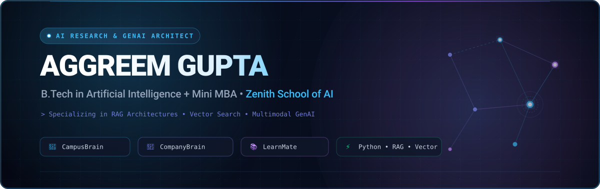

<div align="center">

  <!-- Custom High-Tech Aesthetic AI Banner -->
  <a href="https://github.com/guptaaggreem">
    
  </a>

  <!-- Animated Typing Tagline -->
  <a href="https://git.io/typing-svg">
    
  </a>

  <br/><br/>

  <!-- Primary Navigation: Live Portfolio & Resume -->
  <a href="https://guptaaggreem.github.io" target="_blank">
    
  </a>
  &nbsp;
  <a href="https://guptaaggreem.github.io/resume/" target="_blank">
    
  </a>

  <br/><br/>

  <!-- Social & Profile Badges -->
  <a href="https://www.linkedin.com/in/aggreem-gupta-147778404/" target="_blank">
    
  </a>
  <a href="https://www.skills.google/public_profiles/b1f01234-952a-47b0-90d5-8c911b5c9ff1" target="_blank">
    
  </a>
  <a href="mailto:Guptaaggreem@gmail.com">
    
  </a>
  <a href="https://github.com/guptaaggreem">
    
  </a>

</div>

<br/>

---

### 💫 About Me

```yaml
name: Aggreem Gupta
role: AI Student & GenAI Developer
education: B.Tech in AI + Mini MBA @ Zenith School of AI (Class of 2030)
focus: Generative AI, Retrieval-Augmented Generation (RAG), Vector Search
portfolio: https://guptaaggreem.github.io
resume: https://guptaaggreem.github.io/resume/
location: New Delhi, India
status: Exploring Agentic Workflows & Multimodal AI
```

- 🌐 **Live Portfolio:** Explore my interactive web portfolio at [guptaaggreem.github.io](https://guptaaggreem.github.io).
- 📄 **Creative Resume:** View or print my ATS-ready resume at [guptaaggreem.github.io/resume/](https://guptaaggreem.github.io/resume/).
- 🎓 Currently pursuing a **B.Tech in Artificial Intelligence + Mini MBA** at **Zenith School of AI** *(1st Year)*.
- 🤖 Enthusiastic about **Generative AI, RAG Pipelines, and Semantic Vector Search**, building intelligent agents that eliminate operational bottlenecks.
- 💡 Creator of **CampusBrain** and **CompanyBrain** — enterprise & academic AI hubs transforming manual workflows into conversational intelligence.
- 🛠️ Currently developing **LearnMate** — an intelligent multimodal study companion generating flashcards, mind maps, and 3D visual models.
- 💬 Ask me about: **RAG pipelines, LLM APIs (OpenAI, Gemini, Claude), MongoDB, and Vector Databases**.

---

### 🛠️ Tech Stack & Tools

<div align="center">

#### Core Technologies & Tooling
<a href="https://skillicons.dev">
  
</a>

<br/><br/>

#### AI, Generative Intelligence & Frameworks


#### Data & Development


</div>

---

### 🚀 Featured Projects

<table>
  <tr>
    <td width="50%" valign="top">
      <h3 align="center">🧠 CampusBrain</h3>
      <p align="center">
        <b>AI University Compliance & Policy Intelligence</b>
      </p>
      <p>
        Solves the friction of dense university manuals and policy documents. Ingests student handbooks, exam regulations, and campus bylaws into an optimized <b>RAG pipeline</b> with <b>vector search</b>, giving students instant, reliable answers to administrative queries.
      </p>
      <p>
        <code>Python</code> • <code>RAG</code> • <code>Vector Search</code> • <code>MongoDB</code> • <code>GenAI APIs</code>
      </p>
    </td>
    <td width="50%" valign="top">
      <h3 align="center">🏢 CompanyBrain</h3>
      <p align="center">
        <b>Enterprise Operations & Workforce AI Hub</b>
      </p>
      <p>
        An enterprise AI platform featured on <a href="https://www.linkedin.com/pulse/building-companybrain-from-simple-ai-assistant-ai-powered-gupta-ia3df/">LinkedIn</a>. Features role-based dual dashboards (Employee & Manager) for automated leave/reimbursement approvals, dynamic task & meeting management, and internal policy synthesis.
      </p>
      <p>
        <code>Python</code> • <code>Enterprise RAG</code> • <code>MongoDB</code> • <code>RBAC</code> • <code>GenAI</code>
      </p>
    </td>
  </tr>
  <tr>
    <td colspan="2" valign="top">
      <h3 align="center">📚 LearnMate <small><i>(In Active Development)</i></small></h3>
      <p align="center">
        <b>Multimodal AI Learning & Synthesis Companion</b>
      </p>
      <p align="center">
        Inspired by NotebookLM, LearnMate allows learners to upload curriculum materials, synthesizing them into interactive study assets: <b>flashcards, dynamic mind maps, 3D concept visualizations, and auto-generated presentation decks</b>.
      </p>
      <p align="center">
        <code>Python</code> • <code>Multimodal LLMs</code> • <code>GenAI</code> • <code>RAG</code> • <code>Data Visualization</code>
      </p>
    </td>
  </tr>
</table>

---

### 📈 GitHub Statistics & Activity

<div align="center">
  
  
</div>

<div align="center">
  
</div>

<br/>

---

### 📬 Connect With Me

<div align="center">
  <a href="https://guptaaggreem.github.io" target="_blank">
    
  </a>
  &nbsp;
  <a href="https://guptaaggreem.github.io/resume/" target="_blank">
    
  </a>
  &nbsp;
  <a href="https://www.linkedin.com/in/aggreem-gupta-147778404/">
    
  </a>
  &nbsp;
  <a href="https://www.skills.google/public_profiles/b1f01234-952a-47b0-90d5-8c911b5c9ff1">
    
  </a>
  &nbsp;
  <a href="mailto:Guptaaggreem@gmail.com">
    
  </a>
</div>

<br/>

<div align="center">
  <sub>Designed with ❤️ by <a href="https://github.com/guptaaggreem">Aggreem Gupta</a>. Crafted for precision and clarity.</sub>
</div>
